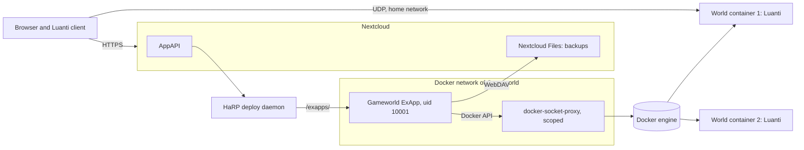
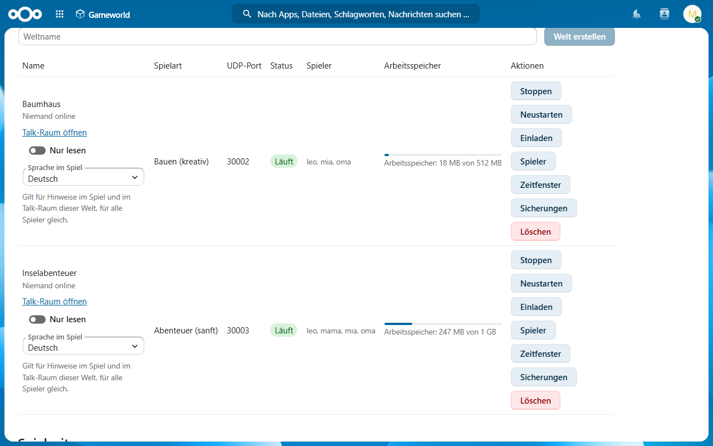
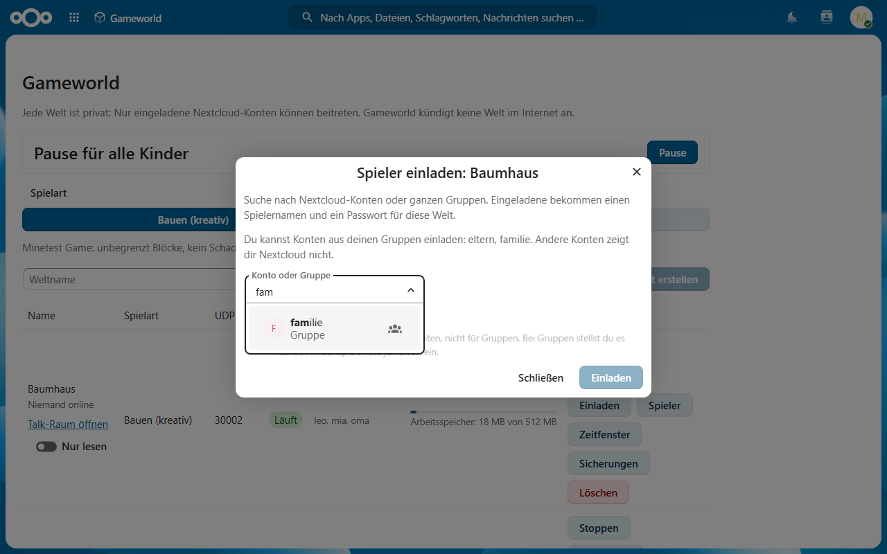
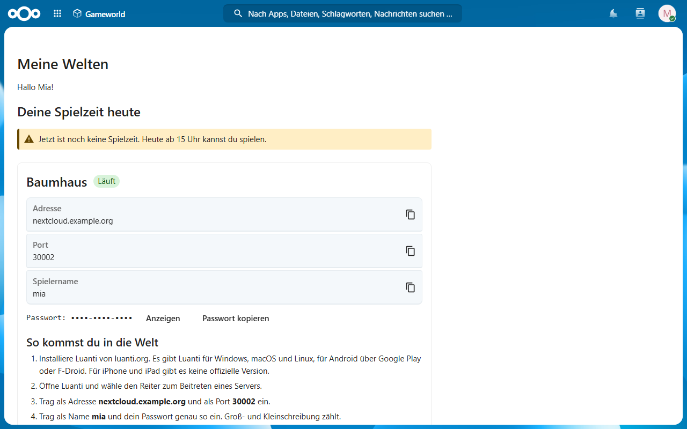
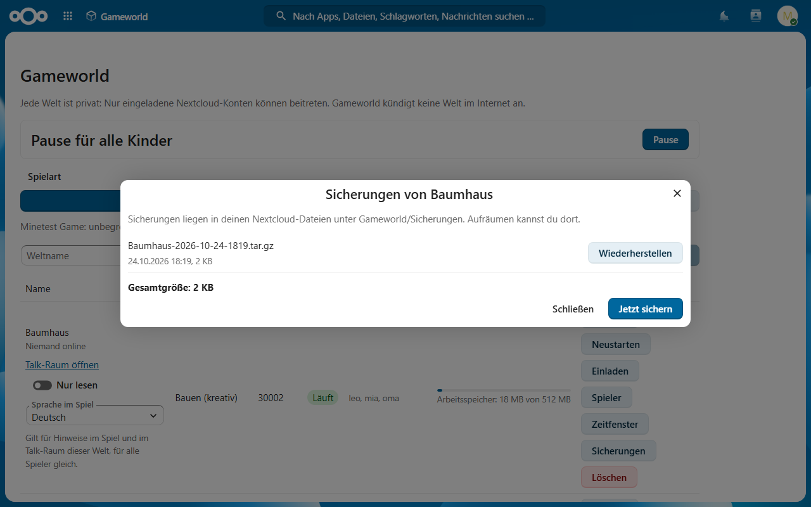
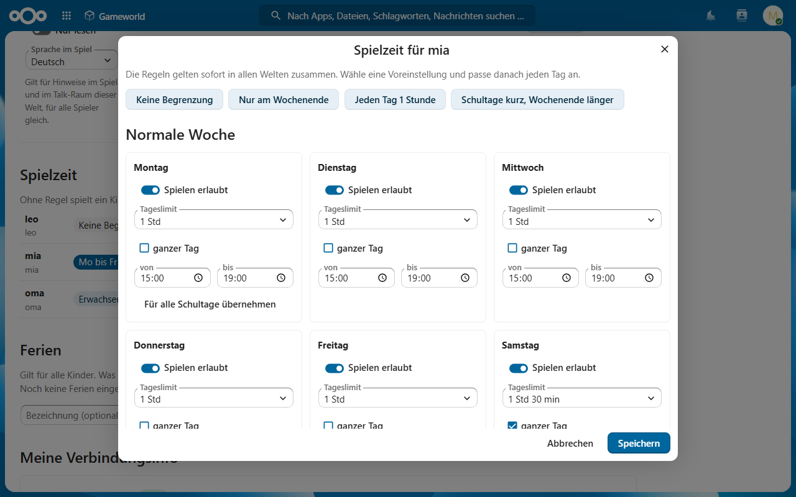
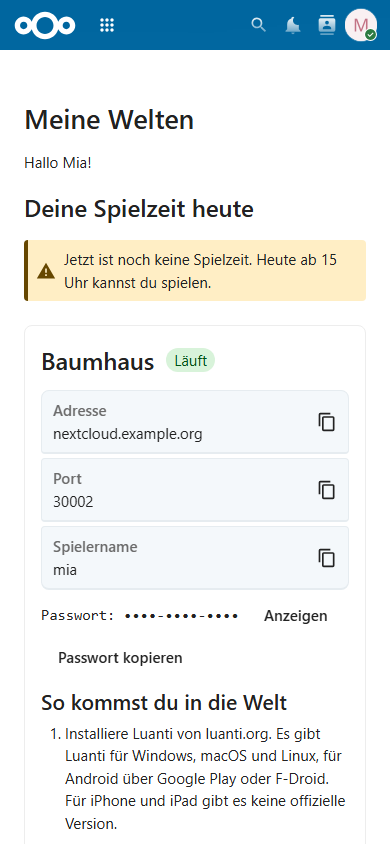

[English](README.md) | **Deutsch** | [Français](README.fr.md)

# Gameworld für Nextcloud

Private Luanti-Spielwelten für Familien und Schulen, auf dem eigenen Nextcloud-Server als
External App (ExApp). Eltern erstellen eine Welt per Klick, laden Kinder und Freunde über ihre
Nextcloud-Konten ein und legen Weltsicherungen in Nextcloud Files ab.

## Was Gameworld kann

- Private Luanti-Welten (kreativ oder sanftes Abenteuer), jede in einem eigenen Container mit
  festen Grenzen für Arbeitsspeicher, CPU und Prozesse
- Nur eingeladene Nextcloud-Konten oder Gruppen kommen hinein; jeder andere Spielername wird
  vor der Anmeldung abgelehnt
- Ein Spielpasswort je Konto, nie gespeichert; Welten bekommen nur einen SRP-Verifier
- Spielzeit je Kind über alle Welten, Ferien, Zeitfenster je Welt, Pause für alle Kinder vom
  Handy aus
- Erwachsen-Schalter: markierte Erwachsene spielen ohne Pause und Spielzeitregeln, nie mit
  Verwaltungs- oder Luanti-Adminrechten
- Verwalter-Gruppen für Schulen und Vereine, eingestellt von Nextcloud-Admins;
  Gruppen-Verwalter laden nur Konten aus den eigenen Gruppen ein
- Sicherungen und Wiederherstellen über Nextcloud Files, geprüft vor jedem Wiederherstellen
- Ein Talk-Raum je Welt mit Gameworld-Bot (optional, wenn Talk installiert ist)
- Welten nur im Heimnetz, nie in einer Serverliste
- Keine Telemetrie, kein Nach-Hause-Telefonieren
- Oberfläche: Deutsch, Englisch, Französisch (folgt der Nextcloud-Kontosprache); Spieltexte je Welt

## Was Gameworld braucht und warum

Gameworld braucht Privilegien, die eine normale Nextcloud-App nicht braucht:

- Docker-Zugriff über einen gescopten `tecnativa/docker-socket-proxy` (Container, Images,
  Volumes, ändernde Anfragen; alles andere zu). Wer diesen Proxy erreicht, hat root-gleiche
  Rechte auf dem Host. Er darf nur im Docker-Netz von Gameworld hängen, nie an einem Host-Port.
- Ein UDP-Port je Welt (Standard 30000 bis 30019), nur im Heimnetz.

Einzelheiten und Restrisiko: [docs/privacy.de.md](docs/privacy.de.md).

## Architektur

## Screenshots

## Voraussetzungen

- Nextcloud 33 bis 35 mit AppAPI und einem HaRP-Deploy-Daemon
- Docker-Engine-API 1.44 oder neuer
- Ein gescopter `tecnativa/docker-socket-proxy` im selben Docker-Netz wie Gameworld

## Installation

1. HaRP und den Docker-Proxy einrichten, siehe [docs/install.de.md](docs/install.de.md)
   (Standard-Compose und Nextcloud All-in-One).
2. Gameworld aus dem Nextcloud App Store installieren (Kategorie Spiele).
3. Gameworld öffnen; der Setup-Check prüft den Proxy vor der ersten Welt. Fehlt der Proxy,
   zeigt er je einen fertigen `docker run`-Befehl für All-in-One und für das eigene Compose
   zum Kopieren.

Deaktivieren und Aktualisieren stoppt und entfernt die Welt-Container; Volumes und Sicherungen
bleiben, die Welten kommen von selbst wieder. Das Deinstallieren lässt Welt-Volumes und
Sicherungen absichtlich stehen; `scripts/gameworld-orphans.sh` listet Reste auf und entfernt
sie, siehe [docs/install.de.md#cleanup](docs/install.de.md#cleanup).

## Dokumentation

- [Installationsanleitung](docs/install.de.md) ([English](docs/install.md))
- [Datenschutz, Privilegien und Datenfluss](docs/privacy.de.md) ([English](docs/privacy.md))
- [Entwicklungsumgebung](docs/dev-setup.md)
- [Mitwirken](CONTRIBUTING.md) und [Sicherheitsrichtlinie](SECURITY.md) (Englisch)

## Lizenz

[AGPL-3.0-or-later](LICENSE)
