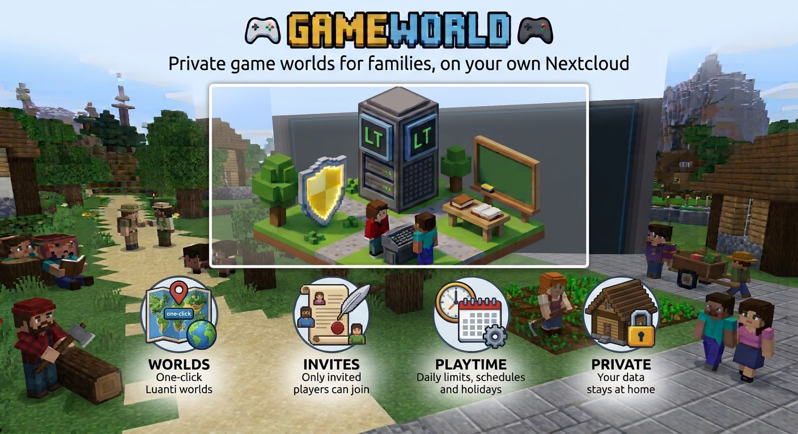
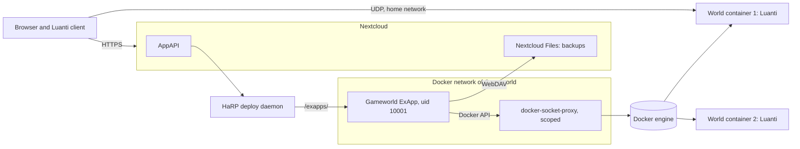
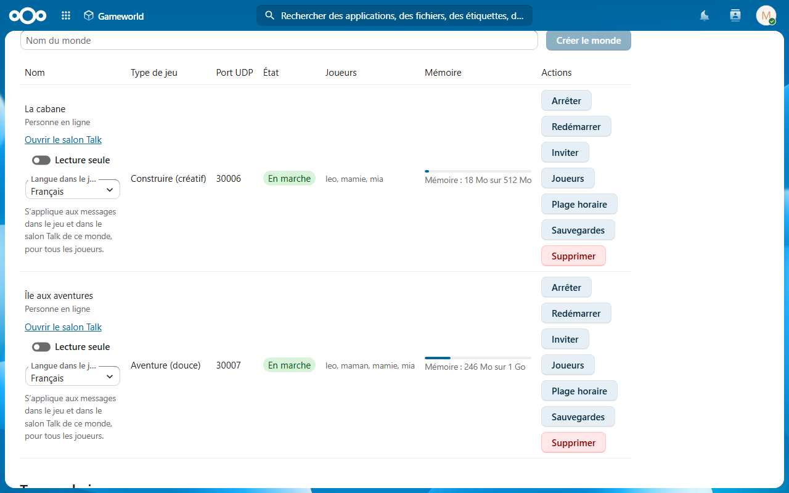
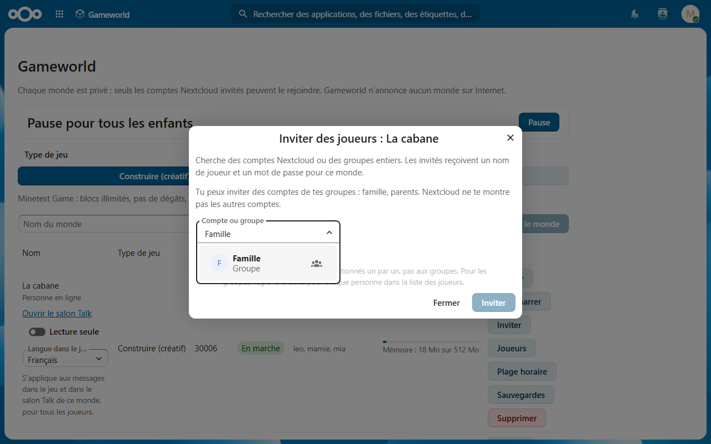
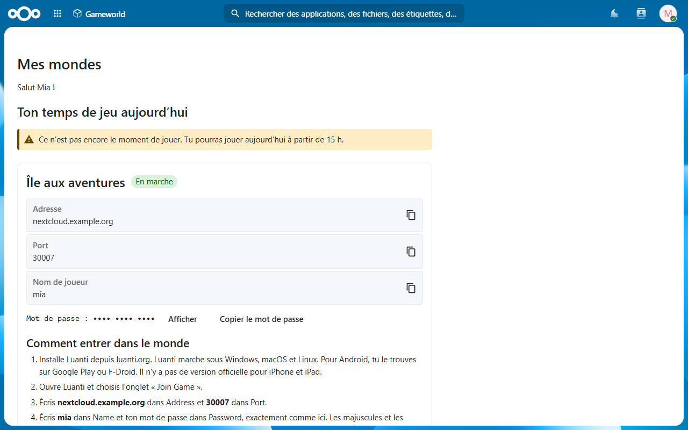
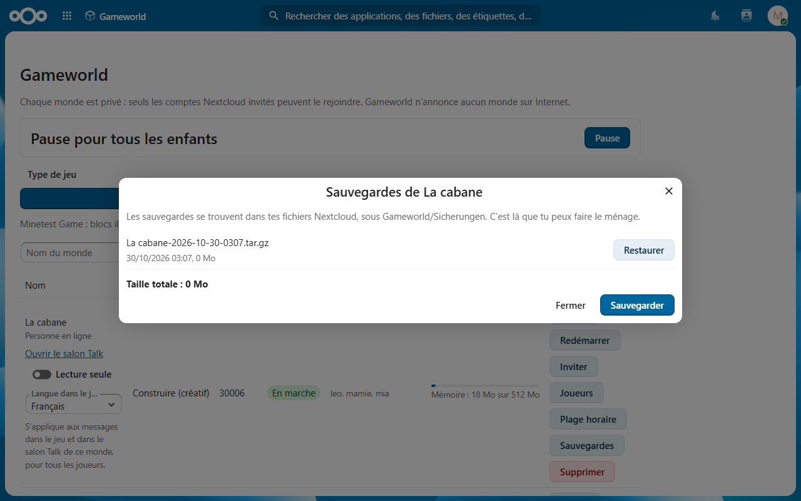
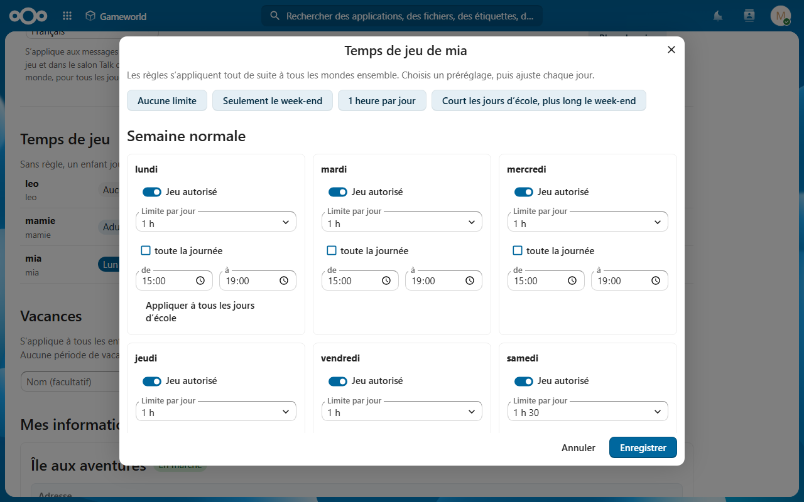
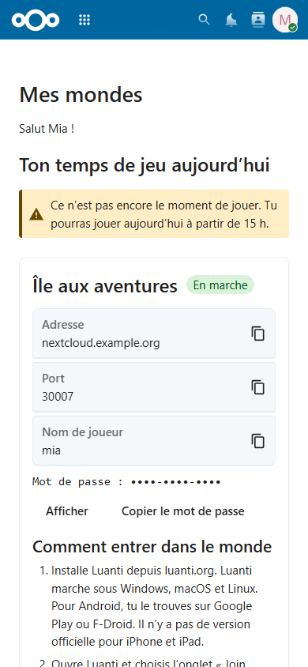

[English](README.md) | [Deutsch](README.de.md) | **Français**

# Gameworld pour Nextcloud

Des mondes de jeu Luanti privés pour les familles et les écoles, sur votre propre serveur
Nextcloud, en tant qu'External App (ExApp). Les parents créent un monde en un clic, invitent
enfants et amis via leurs comptes Nextcloud et conservent les sauvegardes dans Nextcloud Files.

## Ce que fait Gameworld

- Mondes Luanti privés (créatif ou aventure douce), chacun dans son propre conteneur avec des
  limites fixes de mémoire, de CPU et de processus
- Seuls les comptes ou groupes Nextcloud invités peuvent entrer ; tout autre nom de joueur est
  refusé avant la connexion
- Un mot de passe de jeu par compte, jamais stocké ; les mondes ne reçoivent qu'un
  vérificateur SRP
- Temps de jeu par enfant sur tous les mondes, vacances, plages horaires par monde, une pause
  pour tous les enfants depuis le téléphone
- Interrupteur adulte : les adultes marqués jouent sans pause ni règles de temps de jeu,
  jamais avec des droits de gestion ou d'administrateur Luanti
- Groupes de gestionnaires pour écoles et associations, définis par les administrateurs
  Nextcloud ; un gestionnaire de groupe n'invite que des comptes de ses propres groupes
- Sauvegardes et restauration via Nextcloud Files, vérifiées avant chaque restauration
- Un salon Talk par monde avec un bot Gameworld (facultatif, si Talk est installé)
- Mondes réservés au réseau domestique, jamais listés sur une liste de serveurs
- Pas de télémétrie, aucun appel vers l'extérieur
- Interface : allemand, anglais, français (selon la langue du compte Nextcloud) ; textes du jeu par monde

## Ce dont Gameworld a besoin et pourquoi

Gameworld a besoin de privilèges qu'une application Nextcloud ordinaire n'utilise pas :

- Accès à Docker via un `tecnativa/docker-socket-proxy` restreint (conteneurs, images,
  volumes, requêtes de modification ; tout le reste fermé). Qui atteint ce proxy dispose de
  droits équivalents à root sur l'hôte. Il doit rester dans le réseau Docker de Gameworld,
  jamais sur un port de l'hôte.
- Un port UDP par monde (par défaut 30000 à 30019), réseau domestique uniquement.

Détails et risque résiduel : [docs/privacy.md](docs/privacy.md) (en anglais).

## Architecture

## Screenshots

## Prérequis

- Nextcloud 33 à 35 avec AppAPI et un démon de déploiement HaRP
- API Docker Engine 1.44 ou plus récente
- Un `tecnativa/docker-socket-proxy` restreint dans le même réseau Docker que Gameworld

## Installation

1. Mettre en place HaRP et le proxy Docker, voir [docs/install.md](docs/install.md) (en
   anglais ; Compose standard et Nextcloud All-in-One).
2. Installer Gameworld depuis le Nextcloud App Store (catégorie Jeux).
3. Ouvrir Gameworld ; la vérification de configuration teste le proxy avant le premier monde.
   Si le proxy manque, elle affiche une commande `docker run` prête à copier pour All-in-One
   et pour votre propre fichier Compose.

Désactiver ou mettre à jour Gameworld arrête et supprime les conteneurs des mondes ; volumes
et sauvegardes restent, et les mondes reviennent d'eux-mêmes. La désinstallation laisse
volontairement les volumes des mondes et les sauvegardes en place ;
`scripts/gameworld-orphans.sh` liste et supprime les restes, voir
[docs/install.md#cleanup](docs/install.md#cleanup).

## Documentation

- [Guide d'installation](docs/install.md) (en anglais)
- [Confidentialité, privilèges et flux de données](docs/privacy.md) (en anglais)
- [Environnement de développement](docs/dev-setup.md)
- [Contribuer](CONTRIBUTING.md) et [politique de sécurité](SECURITY.md) (en anglais)

## Licence

[AGPL-3.0-or-later](LICENSE)
