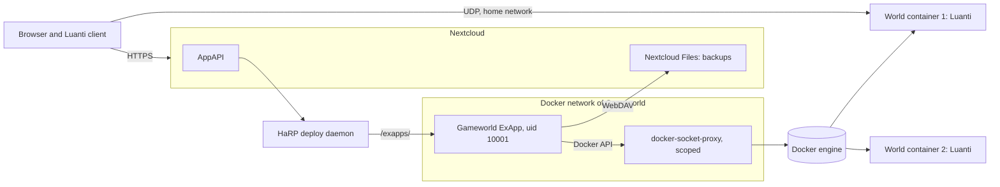

**English** | [Deutsch](README.de.md) | [Français](README.fr.md)

# Gameworld for Nextcloud

Private Luanti game worlds for families and schools, running on your own Nextcloud server as
an External App (ExApp). Parents create a world with one click, invite children and friends
through their Nextcloud accounts and keep world backups in Nextcloud Files.

## What it does

- Private Luanti worlds (creative or gentle adventure), each in its own container with fixed
  memory, CPU and process limits
- Only invited Nextcloud accounts or groups can join; every other player name is refused
  before the login
- One game password per account, never stored; worlds only receive an SRP verifier
- Play time per child across all worlds, holidays, time windows per world, a pause for all
  children from the phone
- Adult switch: marked adults play without pause and play time rules, never with management
  or Luanti admin rights
- Manager groups for schools and clubs, set by Nextcloud admins; group managers invite only
  accounts from their own groups
- Backups and restore through Nextcloud Files, checked before every restore
- One Talk room per world with a Gameworld bot (optional, if Talk is installed)
- Worlds are for the home network only and are never listed on any server list
- No telemetry, no call home
- Interface: German

## What it needs and why

Gameworld needs privileges that an ordinary Nextcloud app does not need:

- Docker access through a scoped `tecnativa/docker-socket-proxy` (containers, images, volumes,
  changing requests; everything else closed). Whoever reaches this proxy has root-equivalent
  rights on the host. It must live inside the Docker network of Gameworld only, never on a
  host port.
- One UDP port per world (default 30000 to 30019), home network only.

Details and the remaining risk: [docs/privacy.md](docs/privacy.md).

## Architecture

## Screenshots

The screenshots follow with the store acceptance of version 1.0.0 (worlds, invite, child view,
backups, play time, phone view).

## Requirements

- Nextcloud 32 to 35 with AppAPI and a HaRP deploy daemon
- Docker Engine API 1.44 or newer
- A scoped `tecnativa/docker-socket-proxy` in the same Docker network as Gameworld

## Installation

1. Set up HaRP and the Docker proxy, see [docs/install.md](docs/install.md) (standard Compose
   and Nextcloud All-in-One).
2. Install Gameworld from the Nextcloud App Store (category Games).
3. Open Gameworld; the setup check tests the proxy before the first world.

Disabling and updating Gameworld stops and removes the world containers; volumes and backups
stay, and the worlds come back on their own. Uninstalling leaves world volumes and backups in
place on purpose; `scripts/gameworld-orphans.sh` lists and removes leftovers, see
[docs/install.md#cleanup](docs/install.md#cleanup).

## Documentation

- [Installation guide](docs/install.md) ([Deutsch](docs/install.de.md))
- [Privacy, privileges and data flow](docs/privacy.md) ([Deutsch](docs/privacy.de.md))
- [Development setup](docs/dev-setup.md)

## Licence

[AGPL-3.0-or-later](LICENSE)
